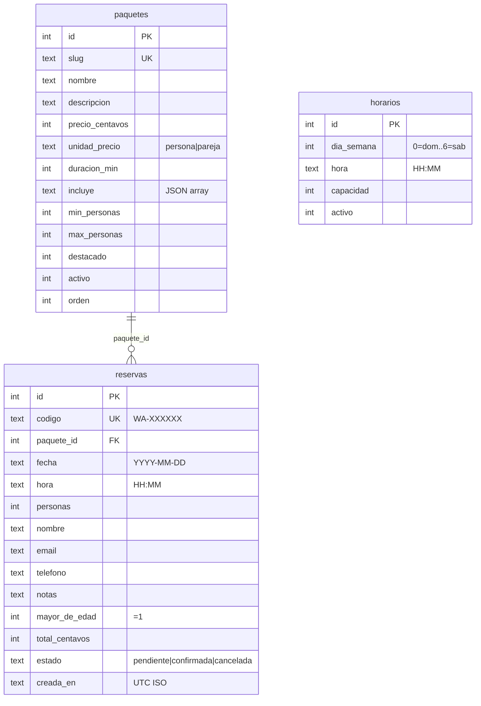

# Base de datos — Wine and Art

Motor: SQLite (better-sqlite3). Archivos en `backend/db/`: `schema.sql`, `seed.sql`, `consultas.sql`.
Precios, horarios y capacidades son placeholders pendientes del cliente.

## Diagrama



`horarios` no tiene FK a `reservas`: la relación es lógica (`reservas.hora` = `horarios.hora` y `strftime('%w', reservas.fecha)` = `horarios.dia_semana`). Así cambiar horarios no rompe reservas históricas.

## Tablas

**paquetes**: catálogo. `slug` único (`pincel-y-copa`, etc.) es el `value` del select del formulario. `incluye` es un arreglo JSON de textos (validado con `json_valid`); la API debe hacer `JSON.parse` antes de responder. `activo=0` oculta un paquete sin borrarlo. `orden` define el orden de las tarjetas. `max_personas >= min_personas`.

**horarios**: sesiones por día de la semana (0=domingo ... 6=sábado, igual que `strftime('%w')`). `UNIQUE(dia_semana, hora)`. `capacidad` = personas máximas por sesión (24). Lun-mié no tienen filas = no disponible.

**reservas**: una fila por reserva. `codigo` lo genera la API (`WA-` + 6 caracteres `A-Z0-9`, reintentar si choca el UNIQUE). `mayor_de_edad` solo acepta 1. `total_centavos` lo calcula el servidor (persona: precio x personas; pareja: precio fijo). `estado` inicia en `pendiente`. `creada_en` en UTC.

## Reglas

- Dinero en centavos enteros (4500 = $45.00).
- CHECKs en BD: unidad, estado, formatos de fecha/hora, personas 1-20, nombre 2-80, notas <= 500, teléfono 10-20 caracteres, email con forma básica, `mayor_de_edad = 1`.
- FK `paquete_id` con `ON DELETE RESTRICT`: no se puede borrar un paquete con reservas (desactivarlo con `activo=0`).
- Cupos restantes = `capacidad - SUM(personas)` de reservas de esa fecha+hora con estado distinto de `cancelada` (ver `consultas.sql`).
- Lo que la BD NO valida y la API (Dan) debe validar: personas dentro de min/max del paquete, fecha >= mañana y <= 6 meses (zona America/Puerto_Rico), que fecha+hora exista en `horarios` activos, que no se exceda el cupo, formato real del teléfono (10 dígitos; guardar normalizado) y total correcto.
- Anti sobreventa: revisar cupo e insertar dentro de una misma `db.transaction()` de better-sqlite3 (síncrona, serializa escrituras).
- Al abrir cada conexión: `PRAGMA foreign_keys = ON;` (SQLite lo trae apagado). Recomendado también `PRAGMA journal_mode = WAL;`.
- Seed idempotente (`INSERT OR IGNORE`). Los índices: `(fecha, hora)`, `estado`, `paquete_id`, `email`, `(activo, orden)`.

## Uso

```
sqlite3 backend/db/wine-and-art.db < backend/db/schema.sql
sqlite3 backend/db/wine-and-art.db < backend/db/seed.sql
```
Con Node: `db.exec(fs.readFileSync('schema.sql','utf8'))`. La ruta del `.db` debe venir de una variable de entorno (`DB_PATH`). El `.db` no se sube a git (agregar `*.db`, `*.db-wal`, `*.db-shm` a `.gitignore`; pendiente para Archi/Xaden).

## Seguridad

- Datos personales: nombre, email, teléfono (y notas). Mínimo necesario, sin datos de pago ni de identificación en la BD.
- No exponer el listado de reservas públicamente. Endpoints públicos permitidos: `GET /api/paquetes`, disponibilidad (solo cupos/horas, sin datos de personas), `POST /api/reservas` y confirmación de una reserva por código sin datos personales. Cualquier listado por fecha (consulta 3) solo detrás de autenticación de admin.
- Consultas siempre parametrizadas (`@fecha`, etc.); nunca concatenar texto del usuario en SQL.
- El código de reserva no debe ser secuencial ni adivinable de forma útil; la confirmación pública no devuelve email ni teléfono.
- Archivo `.db` con permisos restringidos (600) en el servidor; credenciales y rutas solo en variables de entorno.
- Retención: definir con el cliente cuánto tiempo guardar reservas pasadas (pendiente).

## Respaldos

- SQLite: copiar el archivo con la API de backup de better-sqlite3 (`db.backup('respaldo-AAAA-MM-DD.db')`) o `sqlite3 wine-and-art.db ".backup respaldo.db"`. No copiar el `.db` en caliente con `cp` si hay WAL activo (copiar también `-wal`, o usar los métodos anteriores).
- Frecuencia sugerida: diario, conservar 14 copias; copia extra antes de cada migración que altere datos.
- Guardar respaldos fuera del servidor de la app y con acceso restringido (contienen datos personales).
- Restaurar: detener la API, reemplazar el `.db` por la copia, iniciar y probar `SELECT count(*) FROM reservas;`.
- Postgres/Supabase: `pg_dump` (o respaldos automáticos de Supabase) y `pg_restore`/`psql`.

## Migración a PostgreSQL / Supabase

| SQLite | PostgreSQL |
|--------|------------|
| `INTEGER PRIMARY KEY AUTOINCREMENT` | `BIGINT GENERATED ALWAYS AS IDENTITY PRIMARY KEY` |
| `destacado/activo INTEGER 0/1` con CHECK | `BOOLEAN` (el front/API reciben true/false) |
| `mayor_de_edad INTEGER CHECK = 1` | `BOOLEAN NOT NULL CHECK (mayor_de_edad)` |
| `incluye TEXT` + `json_valid` | `JSONB` |
| `fecha TEXT` | `DATE` |
| `hora TEXT 'HH:MM'` | `TIME` (o mantener TEXT con CHECK `~ '^[0-2][0-9]:[0-5][0-9]$'`) |
| `creada_en TEXT DEFAULT strftime(...)` | `TIMESTAMPTZ NOT NULL DEFAULT now()` |
| `GLOB '...'` en CHECK | `~ '^regex$'` |
| `email LIKE '_%@_%._%'` | `~* '^[^@]+@[^@]+\.[^@]+$'` |
| `strftime('%w', fecha)` | `EXTRACT(DOW FROM fecha)` (también 0=domingo) |
| `@param` | `$1, $2` (pg) o `:param` según el cliente |
| `INSERT OR IGNORE` (seed) | `INSERT ... ON CONFLICT DO NOTHING` |
| `PRAGMA foreign_keys` | No aplica (siempre activas) |
| `date(fecha) = fecha` en CHECK | No hace falta con tipo `DATE` |

En Supabase: activar Row Level Security en las tres tablas; `paquetes` y `horarios` con política de solo lectura pública (`activo`), `reservas` sin acceso para `anon` (solo el backend con `service_role`, nunca expuesta al navegador). Si el SQLite pasa a Postgres, migrar con `INSERT` desde un export por tabla, convirtiendo 0/1 a boolean y `incluye` a JSONB.
